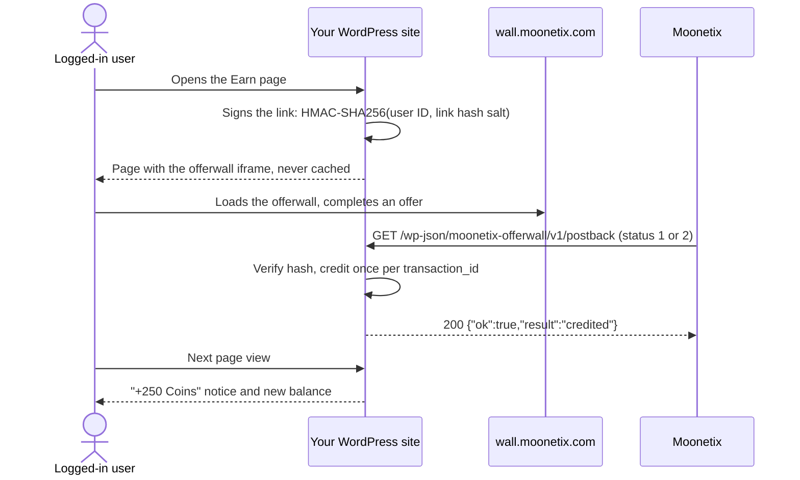

<a href="https://moonetix.com/industries/wordpress"></a>

# Moonetix Offerwall for WordPress

<p>
  <a href="https://github.com/moonetix/moonetix-offerwall-wordpress/actions/workflows/ci.yml"></a>
  <a href="https://moonetix.com/register?from=github-moonetix-offerwall-wordpress"></a>
  <a href="https://docs.moonetix.com/wordpress"></a>
  
  
  
</p>

> **Add the Moonetix offerwall to a WordPress site without writing code.** Logged-in users earn your points by completing offers, the plugin credits them from verified postbacks, and you earn for every completed offer.

The official WordPress plugin for [Moonetix](https://moonetix.com/), an affiliate network. Show the Moonetix offerwall to your logged-in users and credit their rewards automatically, to a built-in balance, myCred, GamiPress, or TeraWallet (WooCommerce wallet).

- **No code to write.** Blocks and shortcodes for the offerwall, the balance and the reward history, and a one-click Earn page.
- **Safe reward crediting.** Every postback is checked with HMAC-SHA256 and a constant-time comparison, each transaction is credited once, and a reversal only takes back what was credited.
- **Fits your site.** Floating Earn button, menu items that open the offerwall in a window, "Who can earn" by user role, page caching support, keys in `wp-config.php`.
- **Built into WordPress.** Settings API, Site Health check, dashboard widget, privacy export and erase.

The plugin has been submitted to the WordPress.org plugin directory and is waiting for review.

## How it works



1. The plugin builds `https://wall.moonetix.com/<App ID>?user_id=<WordPress user ID>&hash=<HMAC>` on your server for the logged-in user. Visitors who are not logged in see your login message instead.
2. Moonetix calls the REST route above for every reward (status 1) and every reversal (status 2).
3. The route checks the hash with `hash_equals` before anything is written, then records the reward in the ledger table under a unique `transaction_id` and passes it to the destination you chose.
4. A reversal takes back only what that transaction credited. A repeat of the same postback answers 200 and changes nothing.

## Requirements

- WordPress 6.3 or newer, PHP 7.4 or newer
- HTTPS
- A free Moonetix publisher account and an approved offerwall for your site: [sign up](https://moonetix.com/register?from=github-moonetix-offerwall-wordpress)

## Install

1. Download the latest zip from [Releases](https://github.com/moonetix/moonetix-offerwall-wordpress/releases) or from [moonetix.com](https://moonetix.com/downloads/moonetix-offerwall-1.0.0.zip).
2. In WordPress, go to Plugins, Add New Plugin, Upload Plugin, choose the zip, and activate it.
3. Open Settings, Moonetix Offerwall, and paste your App ID, link hash salt and postback secret key. Each field says where to find it in your Moonetix dashboard.
4. Copy the postback URL from the plugin into the Postback page of your Moonetix dashboard, and send a test postback.
5. Click **Create the Earn page**, check the draft, and publish it.

Full setup guide: [docs.moonetix.com/wordpress](https://docs.moonetix.com/wordpress)

## Shortcodes and blocks

| Shortcode | Block | Shows |
| --- | --- | --- |
| `[moonetix_offerwall height="900"]` | Moonetix Offerwall | The offerwall for the logged-in user. `height` in pixels, 400 to 3000. Without it, the Height setting is used (default 900). |
| `[moonetix_balance]` | Moonetix Balance | The user's balance, with your balance label |
| `[moonetix_history limit="20"]` | Moonetix Reward History | The user's rewards and reversals. `limit` 1 to 100, default 20. |

Any menu item or button with the CSS class `moonetix-ow-open` opens the offerwall in a window (turn on menu links under Display).

## Settings

Everything lives in one option, `moonetix_offerwall_settings`, edited under Settings, Moonetix Offerwall.

| Setting | Default | Notes |
| --- | --- | --- |
| App ID | empty | Offerwalls, Copy ID next to your offerwall |
| Link hash salt | empty | Your offerwall, Integration, Link security. Can come from `MOONETIX_OFFERWALL_LINK_SALT`. |
| Postback secret key | empty | Postback page. Can come from `MOONETIX_OFFERWALL_POSTBACK_KEY`. Without it every postback gets 503. |
| Rewards go to | Built-in balance | myCRED (point type), GamiPress (points type) or TeraWallet appear when that plugin is active. TeraWallet uses a points-per-currency-unit rate, default 1. |
| Who can earn | All logged-in users | Or only the roles you tick. Others see your "members only" message. |
| Height | 900 | Offerwall height in pixels, 400 to 3000 |
| Floating Earn button | Off | Side (right or left), devices (all, phones, computers), pages to hide it on, hidden on cart and checkout by default |
| Reward notice | On | The "+250 Coins" notice on the next page view |
| Credit link | Off | Optional "Rewards by Moonetix" link under the offerwall |
| Delete all plugin data | Off | When ticked, deleting the plugin removes its ledger table, balances and settings. Otherwise they are kept. |

Keys in `wp-config.php` win over the database and are never shown in the settings page:

```php
define( 'MOONETIX_OFFERWALL_LINK_SALT', '...' );
define( 'MOONETIX_OFFERWALL_POSTBACK_KEY', '...' );
```

## Postback endpoint

The settings page shows the full URL to paste into the Postback page of your dashboard:

```
https://your-site.example/wp-json/moonetix-offerwall/v1/postback?user_id={user_id}&transaction_id={transaction_id}&reward={reward}&status={status}&hash={hash}&offer_name={offer_name}&offer_id={offer_id}&payout={payout}&country={country}&device={device}
```

| Answer | `result` or error code | When |
| --- | --- | --- |
| 200 | `credited`, `reversed`, `duplicate`, `ignored`, `unknown_user` | Handled. `ignored` is a reversal for a transaction that was never credited. `unknown_user` means no WordPress user has that ID. |
| 400 | `moonetix_offerwall_bad_request` | A signed parameter is missing or malformed |
| 403 | `moonetix_offerwall_bad_hash` | The hash does not match the postback secret key |
| 503 | `moonetix_offerwall_not_configured` | The postback secret key is not set |
| 503 | `destination_unavailable` | The points plugin you chose is inactive, or TeraWallet refused the change |

Moonetix retries a postback that did not get a 2xx answer, so a reward refused with 503 still arrives once you fix the setting.

## For developers

| Hook | Type | Arguments | Use |
| --- | --- | --- | --- |
| `moonetix_offerwall_user_id` | Filter | user ID string, WordPress user ID | Change the user ID sent to Moonetix. Keep it stable and never use an email address. |
| `moonetix_offerwall_postback_user` | Filter | WordPress user ID or 0, Moonetix user ID | Map a postback user ID back to a WordPress user. Pair it with the filter above. |
| `moonetix_offerwall_can_earn` | Filter | bool, WordPress user ID | Decide per user who sees the offerwall and the floating button |
| `moonetix_offerwall_show_floating` | Filter | bool | Show or hide the floating button on the current page |
| `moonetix_offerwall_postback` | Action | result, WordPress user ID, signed values | Runs after every postback that passed the hash check |
| `moonetix_offerwall_balance_changed` | Action | WordPress user ID, change, transaction ID | Runs when the built-in balance changes |

## Testing

1. Paste the postback URL into your dashboard. On the Postback page, or under Offerwalls, your offerwall, Integration, click **Send a test postback**.
2. Send status 1 with the WordPress user ID of a test account. The Postbacks tab shows Credited and the balance goes up.
3. Send status 2. Every dashboard test gets a new `test_` transaction ID, so this reversal has no credit to take back: it answers 200 with `ignored` and the balance does not move.
4. Open the Earn page from a normal home or mobile connection. Over a VPN or a proxy the offerwall shows a block page instead of offers.

To see a retry and a real reversal, run [postback-tester](https://github.com/moonetix/postback-tester) against the site with a test account. It signs postbacks exactly like Moonetix and sends a credit and its retry, three kinds of reversal, four forged or unsigned requests and five parallel copies of one credit:

```sh
export MOONETIX_POSTBACK_KEY=your-postback-secret-key
npx github:moonetix/postback-tester --preset moonetix \
  'https://your-site.example/wp-json/moonetix-offerwall/v1/postback?user_id={user_id}&transaction_id={transaction_id}&reward={reward}&status={status}&hash={hash}' --user 2
```

Remove the test rewards afterwards. CI runs `php -l` on every file with PHP 7.4 and 8.3.

## Troubleshooting

| What you see | Fix |
| --- | --- |
| "Link not valid" inside the offerwall | The link hash salt does not match. Copy it again from Integration, Link security. |
| The offerwall frame stays empty | The website registered for your offerwall is not this site, or the page is not on HTTPS. |
| Test postbacks never reach the Postbacks tab | A security plugin, firewall or host blocks the WordPress REST API. Allow the `moonetix-offerwall` route. The status box has a Test the postback URL button. |
| Postbacks get 403 | The postback secret key in the plugin is not the one on your Postback page. |
| Postbacks get 503 | The postback secret key is empty, or the points plugin you chose is not active. |
| Users see "available to members only" | Their role is not ticked under Who can earn. |

## Security

- Links are signed on the server for the logged-in user. The salt and the postback key never reach the browser.
- Postbacks are verified with HMAC-SHA256 and `hash_equals` before anything is written. Each `transaction_id` is unique in the ledger, so concurrent repeats credit once.
- Pages with a user's link, balance or history send `DONOTCACHEPAGE` and no-cache headers. If your CDN caches whole pages, bypass it for logged-in users.
- Reward users only for completed offers. Never reward joins, invites, likes, reviews or other engagement. Users must be 16 or older.

Found a security issue? Please email support@moonetix.com instead of opening a public issue.

## Links

- [Setup guide](https://docs.moonetix.com/wordpress)
- [How to add an offerwall to WordPress](https://moonetix.com/academy/integrations/offerwall-wordpress)
- [Moonetix for WordPress sites](https://moonetix.com/industries/wordpress)

## Get started

**[Sign up free at moonetix.com](https://moonetix.com/register?from=github-moonetix-offerwall-wordpress)**, add your site, and paste the three keys into the plugin. Every publisher application is reviewed by hand, and once approved your site goes live right away.

## More Moonetix examples

- **Start here:** [awesome-offerwalls](https://github.com/moonetix/awesome-offerwalls), [offerwall-postback-handlers](https://github.com/moonetix/offerwall-postback-handlers)
- **SDKs:** [moonetix-android-sdk](https://github.com/moonetix/moonetix-android-sdk), [moonetix-ios-sdk](https://github.com/moonetix/moonetix-ios-sdk), [moonetix-flutter](https://github.com/moonetix/moonetix-flutter), [moonetix-react-native](https://github.com/moonetix/moonetix-react-native), [moonetix-unity](https://github.com/moonetix/moonetix-unity)
- **Web and backends:** [offerwall-nextjs-starter](https://github.com/moonetix/offerwall-nextjs-starter), [offerwall-react-vite](https://github.com/moonetix/offerwall-react-vite), [offerwall-vue-nuxt](https://github.com/moonetix/offerwall-vue-nuxt), [offerwall-express](https://github.com/moonetix/offerwall-express), [offerwall-laravel](https://github.com/moonetix/offerwall-laravel), [offerwall-django](https://github.com/moonetix/offerwall-django), [offerwall-firebase-functions](https://github.com/moonetix/offerwall-firebase-functions), [offerwall-supabase](https://github.com/moonetix/offerwall-supabase), [rewards-site-starter](https://github.com/moonetix/rewards-site-starter)
- **Apps and games:** [offerwall-flutter-example](https://github.com/moonetix/offerwall-flutter-example), [offerwall-react-native-example](https://github.com/moonetix/offerwall-react-native-example), [offerwall-unity-example](https://github.com/moonetix/offerwall-unity-example), [offerwall-godot](https://github.com/moonetix/offerwall-godot), [offerwall-html5-game](https://github.com/moonetix/offerwall-html5-game)
- **Communities and desktop:** [telegram-mini-app-offerwall](https://github.com/moonetix/telegram-mini-app-offerwall), [discord-rewards-bot](https://github.com/moonetix/discord-rewards-bot), [offerwall-chrome-extension](https://github.com/moonetix/offerwall-chrome-extension), [offerwall-electron](https://github.com/moonetix/offerwall-electron)
- **Tools and data:** [postback-tester](https://github.com/moonetix/postback-tester), [signup-guard](https://github.com/moonetix/signup-guard), [datacenter-ip-ranges](https://github.com/moonetix/datacenter-ip-ranges), [reward-economy-kit](https://github.com/moonetix/reward-economy-kit), [referral-engine](https://github.com/moonetix/referral-engine), [gamification-kit](https://github.com/moonetix/gamification-kit), [offerwall-fraud-playbook](https://github.com/moonetix/offerwall-fraud-playbook), [affiliate-postback-macros](https://github.com/moonetix/affiliate-postback-macros), [country-tiers](https://github.com/moonetix/country-tiers)

## License

GPLv2 or later. See [LICENSE](LICENSE).
