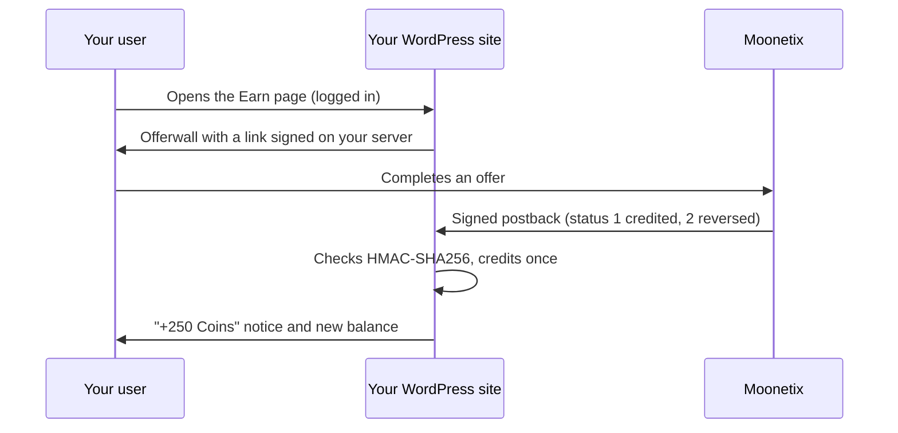

<a href="https://moonetix.com/industries/wordpress"></a>

# Moonetix Offerwall for WordPress

<p>
  <a href="https://moonetix.com/register"></a>
  <a href="https://docs.moonetix.com/wordpress"></a>
  
  
  
</p>

> **Turn your logged-in users into revenue.** No code, no ads in their face: users earn your points by completing offers, you earn for every completed offer.

The official WordPress plugin for [Moonetix](https://moonetix.com/), a pay-per-result affiliate network. Show the Moonetix offerwall to your logged-in users and credit their rewards automatically, to a built-in balance, myCred, GamiPress, or TeraWallet (WooCommerce wallet).

- **No code to write.** Blocks and shortcodes for the offerwall, the balance and the reward history, and a one-click Earn page.
- **Safe reward crediting.** Every postback is checked with HMAC-SHA256 and a constant-time comparison, each transaction is credited once, and a reversal only takes back what was credited.
- **Fits your site.** Floating Earn button, menu items that open the offerwall in a window, "Who can earn" by user role, page caching support, keys in `wp-config.php`.
- **Built into WordPress.** Settings API, Site Health check, dashboard widget, privacy export and erase.

The plugin has been submitted to the WordPress.org plugin directory and is waiting for review.

## How it works



## Requirements

- WordPress 6.3 or newer, PHP 7.4 or newer
- HTTPS
- A free Moonetix publisher account and an approved offerwall for your site: [sign up](https://moonetix.com/register)

## Install

1. Download the latest zip from [Releases](https://github.com/moonetix/moonetix-offerwall-wordpress/releases) or from [moonetix.com](https://moonetix.com/downloads/moonetix-offerwall-1.0.0.zip).
2. In WordPress, go to Plugins, Add New Plugin, Upload Plugin, choose the zip, and activate it.
3. Open Settings, Moonetix Offerwall, and paste your App ID, link hash salt and postback secret key. Each field says where to find it in your Moonetix dashboard.
4. Copy the postback URL from the plugin into the Postback page of your Moonetix dashboard, and send a test postback.
5. Click **Create the Earn page**, check the draft, and publish it.

Full setup guide: [docs.moonetix.com/wordpress](https://docs.moonetix.com/wordpress)

## Shortcodes

| Shortcode | Shows |
| --- | --- |
| `[moonetix_offerwall height="900"]` | The offerwall for the logged-in user |
| `[moonetix_balance]` | The user's balance |
| `[moonetix_history limit="20"]` | The user's rewards and reversals |

## For developers

| Hook | Type | Use |
| --- | --- | --- |
| `moonetix_offerwall_user_id` | Filter | Change the user ID sent to Moonetix |
| `moonetix_offerwall_postback_user` | Filter | Map a postback user ID back to a WordPress user |
| `moonetix_offerwall_can_earn` | Filter | Decide per user who sees the offerwall |
| `moonetix_offerwall_show_floating` | Filter | Show or hide the floating button on a page |
| `moonetix_offerwall_postback` | Action | Runs after every verified postback |
| `moonetix_offerwall_balance_changed` | Action | Runs when the built-in balance changes |

Keys can live in `wp-config.php`:

```php
define( 'MOONETIX_OFFERWALL_LINK_SALT', '...' );
define( 'MOONETIX_OFFERWALL_POSTBACK_KEY', '...' );
```

## Security

Found a security issue? Please email support@moonetix.com instead of opening a public issue.

## Links

- [Setup guide](https://docs.moonetix.com/wordpress)
- [How to add an offerwall to WordPress](https://moonetix.com/academy/integrations/offerwall-wordpress)
- [Moonetix for WordPress sites](https://moonetix.com/industries/wordpress)

## Get started

**[Sign up free at moonetix.com](https://moonetix.com/register)**, add your site, and paste the three keys into the plugin. Every publisher application is reviewed by hand, and once approved your site goes live right away.

## License

GPLv2 or later. See [LICENSE](LICENSE).
